<div align="center">

# Crypto From Scratch

**Build the algorithms. See the bits change. Understand the limits.**

Python 3.10+ · Standard-library runtime · Interactive local lab · MIT

[Start the lab](#quick-start) · [Explore the algorithms](#what-is-inside) · [Animated tour](#animated-tour) · [API](#api-reference) · [Validation](#validation) · [Documentation](docs/README.md)

</div>

An educational cryptography project that starts with Euclid and ends with an
authenticated conversation between Alice and Bob. RSA, Diffie–Hellman, SHA-256,
HMAC, Feistel, **AES-128/192/256 and AES-GCM** are implemented in readable Python.
The browser workbench calls these implementations directly, so every displayed
result comes from an actual calculation.

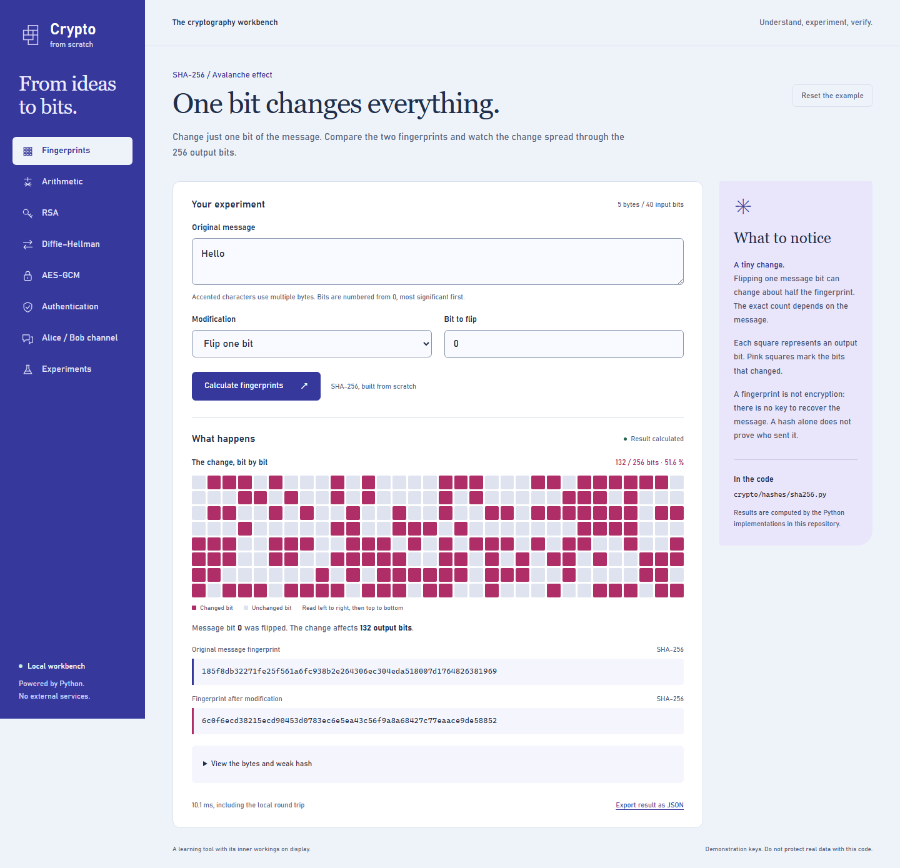

> [!WARNING]
> This is a learning project, not a production cryptography library. Textbook
> RSA has no OAEP or PSS, the simulated channel uses a toy Feistel cipher and
> a tiny DH group, and the Python implementations are not audited or constant
> time. Do not use this code to protect real data.

## Quick start

From the repository root, with Python 3.10 or newer:

```console
python -m crypto.lab
```

Open **http://127.0.0.1:8000**. No installation, JavaScript build step, external
fonts or runtime dependencies are needed. Stop with Ctrl+C.

```console
python -m crypto.lab --open
python -m crypto.lab --port 8001
```

The interface, this README and the animated Python walkthrough are in English.
The original specification and deeper course notes remain in French.

**Try it:** flip one input bit in the hash workspace; compare Alice and Bob's
DH secrets; encrypt with GCM, switch to verification and change a tag digit;
then watch the channel reject tampering and a replay. Export the real results
as JSON, including their demonstration parameters.

<details>
<summary>Watch a tour of the actual interface</summary>

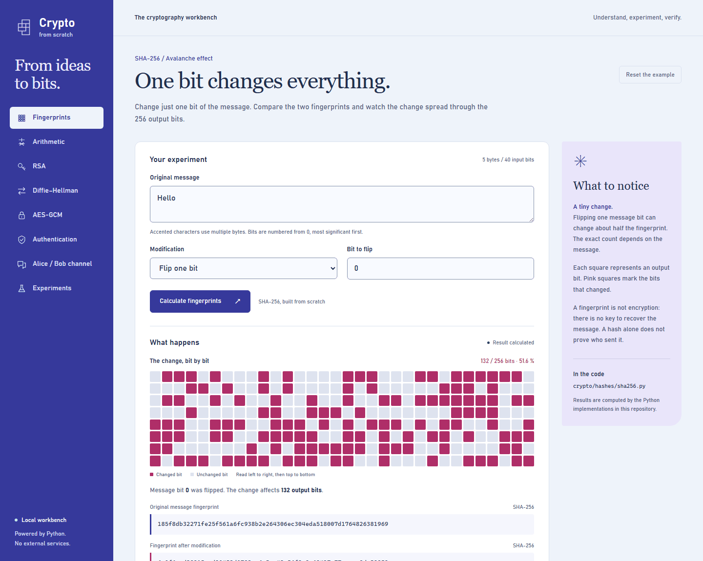

This GIF contains real browser screenshots of executed experiments. It is a
short tour, not a continuous screen recording. [Still desktop view](docs/assets/lab.png)
· [Mobile view](docs/assets/lab-mobile.png) · [Lab guide and design references](docs/lab.md)

</details>

## Installation

A virtual environment is recommended for development:

```powershell
python -m venv .venv
.venv\Scripts\Activate.ps1
python -m pip install -e ".[test,docs]"
python -m pytest
```

On macOS/Linux, activate with `source .venv/bin/activate` instead.
For the library and lab only, use `python -m pip install -e .`.
After installation, `crypto-lab` is also available as a launcher.

| Extra | Dependencies | Purpose |
|---|---|---|
| None | Python standard library | Algorithms, examples, local browser lab |
| `test` | pytest, cryptography | Tests and independent AES/GCM references |
| `docs` | Pillow, Matplotlib | Animated examples and scientific figures |
| `ui-test` | Playwright, Pillow | Browser checks and real interface captures |

## What is inside

| Area | Implemented here | Observe in the lab |
|---|---|---|
| Number theory | Euclid, Bézout, inverses, fast modular powers, primality, prime generation, factorization | Division trace, identity and factors |
| RSA | Integer and byte/block encryption, key generation, JSON keys | Key components, ciphertext and text round trip |
| Diffie–Hellman | Validated prime-field exchange | Public values and shared secrets |
| Hashing | Weak educational hash, incremental SHA-256, avalanche measurements | A 256-bit difference grid |
| Symmetric encryption | Feistel, AES-128/192/256, PKCS#7, ECB/CBC/CTR, AES-GCM | GCM envelope and visible block repetitions |
| Authentication | HMAC-SHA256 and educational hash-then-RSA signatures | Accept/reject comparison for changed messages |
| Protocol | PSK-authenticated DH, directional keys, encrypt-then-HMAC, ordered delivery | Tampering and replay rejection |
| Experiments | Five local toy attacks, timing/allocation benchmarks, studies A–F | Executed attack results and live measurements |

The [completion matrix](docs/completion.md) maps the original V1–V14 requirements
to implementations, tests and recorded results. RSA-PSS, ECDSA and EdDSA are
explained conceptually as requested; they are not implemented APIs. The channel
is an in-memory simulation, not a network protocol or TLS implementation.

## Use the library

```python
from crypto.hashes import sha256
from crypto.symmetric import gcm_encrypt, gcm_decrypt

assert sha256(b"abc").hex() == (
    "ba7816bf8f01cfea414140de5dae2223"
    "b00361a396177a9cb410ff61f20015ad"
)

# Fixed public demonstration key. Use only for this learning example.
key = bytes(range(16))
nonce, ciphertext, tag = gcm_encrypt(b"Hello, Bob!", key, aad=b"Alice")
assert gcm_decrypt(ciphertext, key, nonce, tag, aad=b"Alice") == b"Hello, Bob!"
# A fresh random nonce was generated. Never reuse a nonce with the same key.
```

Prefer a terminal walkthrough:

```console
python -m examples.aes_gcm
python -m examples.secure_channel
python -m examples.tour
python -m experiments.attacks.run
```

## Animated tour

Open a chapter to see the animation, the executable code and its recorded
output. Each scene runs independently; steps within a scene share variables.
Animations last about 15–22 seconds and loop. A still alternative accompanies
each one. Outputs are captured from executed Python, never invented; random
keys and benchmark timings can change when regenerated.

| Foundations | Algorithms | Systems |
|---|---|---|
| [Mathematics](#demo-math) | [RSA](#demo-rsa) | [Authentication](#demo-authentication) |
| [Shared secrets](#demo-dh) | [AES](#demo-aes) | [Alice/Bob channel](#demo-channel) |
| [Hash avalanche](#demo-hash) | [Block modes and GCM](#demo-modes) | [Toy attacks](#demo-attacks) |
| | | [Benchmarks](#demo-benchmarks) |

<a id="demo-math"></a>

<details>
<summary>01 / Mathematical foundations</summary>

V1–V2 · Compute before encrypting.

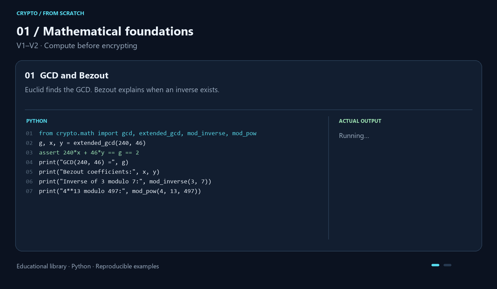

[Still image](docs/assets/math.png) · Run: `python -m examples.tour math`

**GCD and Bezout.** Euclid finds the GCD. Bezout explains when an inverse exists.

```python
from crypto.math import gcd, extended_gcd, mod_inverse, mod_pow
g, x, y = extended_gcd(240, 46)
assert 240*x + 46*y == g == 2
print("GCD(240, 46) =", g)
print("Bezout coefficients:", x, y)
print("Inverse of 3 modulo 7:", mod_inverse(3, 7))
print("4**13 modulo 497:", mod_pow(4, 13, 497))
```

```text
GCD(240, 46) = 2
Bezout coefficients: -9 47
Inverse of 3 modulo 7: 5
4**13 modulo 497: 445
```

**Primes and factors.** Miller-Rabin tests candidates; trial division recovers small factors.

```python
from crypto.math import generate_prime, is_probable_prime, factorize
prime = generate_prime(64)
assert prime.bit_length() == 64
print("Generated prime:", prime.bit_length(), "bits")
print("Miller-Rabin test:", is_probable_prime(prime))
print("Factors of 3233:", factorize(3233))
```

```text
Generated prime: 64 bits
Miller-Rabin test: True
Factors of 3233: [53, 61]
```

</details>

<a id="demo-rsa"></a>

<details>
<summary>02 / RSA: from integers to messages</summary>

V3–V4 · Keys, encoding and reconstruction.

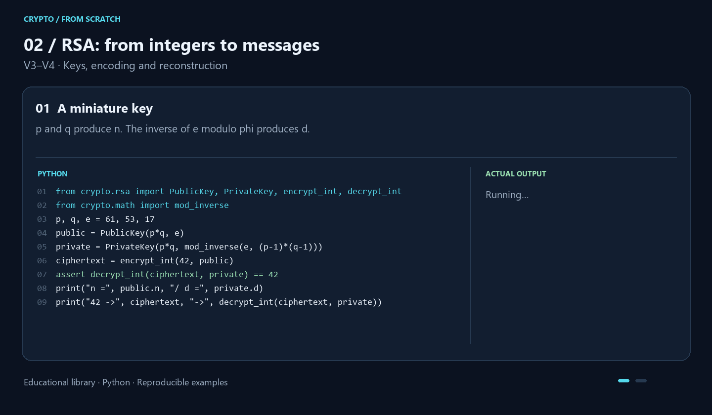

[Still image](docs/assets/rsa.png) · Run: `python -m examples.tour rsa`

**A miniature key.** p and q produce n. The inverse of e modulo phi produces d.

```python
from crypto.rsa import PublicKey, PrivateKey, encrypt_int, decrypt_int
from crypto.math import mod_inverse
p, q, e = 61, 53, 17
public = PublicKey(p*q, e)
private = PrivateKey(p*q, mod_inverse(e, (p-1)*(q-1)))
ciphertext = encrypt_int(42, public)
assert decrypt_int(ciphertext, private) == 42
print("n =", public.n, "/ d =", private.d)
print("42 ->", ciphertext, "->", decrypt_int(ciphertext, private))
```

```text
n = 3233 / d = 2753
42 -> 2557 -> 42
```

**Text, blocks and JSON.** Encoding preserves bytes and their length. It does not replace OAEP.

```python
from crypto.rsa import generate_keypair, encrypt_text, decrypt_text
public, private = generate_keypair(256)
encrypted = encrypt_text("Bonjour, RSA !", public)
assert PublicKey.from_json(public.to_json()) == public
print("Encrypted blocks:", len(encrypted.blocks))
print("Recovered message:", decrypt_text(encrypted, private))
print("Public key JSON: round trip OK")
```

```text
Encrypted blocks: 1
Recovered message: Bonjour, RSA !
Public key JSON: round trip OK
```

</details>

<a id="demo-dh"></a>

<details>
<summary>03 / Establish a shared secret</summary>

V5 · Diffie-Hellman, without sending the secret.

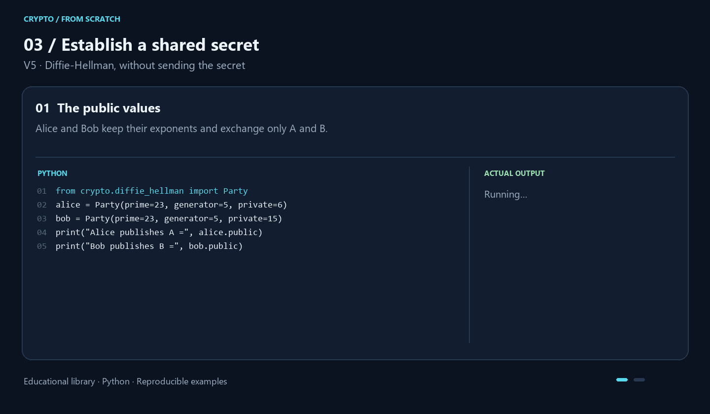

[Still image](docs/assets/dh.png) · Run: `python -m examples.tour dh`

**The public values.** Alice and Bob keep their exponents and exchange only A and B.

```python
from crypto.diffie_hellman import Party
alice = Party(prime=23, generator=5, private=6)
bob = Party(prime=23, generator=5, private=15)
print("Alice publishes A =", alice.public)
print("Bob publishes B =", bob.public)
```

```text
Alice publishes A = 8
Bob publishes B = 19
```

**The same result.** Both calculations produce g^(ab) mod p. The peer still needs authentication.

```python
secret_a = alice.shared_secret(bob.public)
secret_b = bob.shared_secret(alice.public)
assert secret_a == secret_b
print("Alice secret:", secret_a)
print("Bob secret:  ", secret_b)
print("Matching secrets:", secret_a == secret_b)
```

```text
Alice secret: 2
Bob secret:   2
Matching secrets: True
```

</details>

<a id="demo-hash"></a>

<details>
<summary>04 / One bit changes the fingerprint</summary>

V6–V7 · SHA-256 and the avalanche effect.

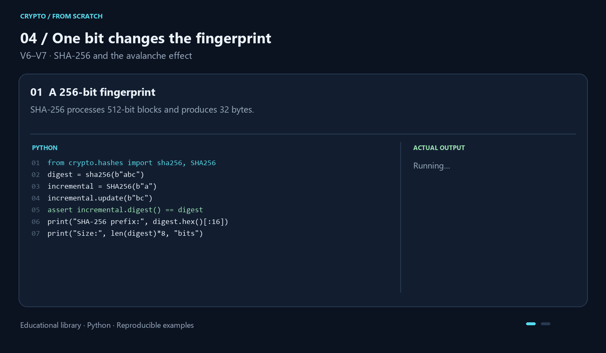

[Still image](docs/assets/hash.png) · Run: `python -m examples.tour hash`

**A 256-bit fingerprint.** SHA-256 processes 512-bit blocks and produces 32 bytes.

```python
from crypto.hashes import sha256, SHA256
digest = sha256(b"abc")
incremental = SHA256(b"a")
incremental.update(b"bc")
assert incremental.digest() == digest
print("SHA-256 prefix:", digest.hex()[:16])
print("Size:", len(digest)*8, "bits")
```

```text
SHA-256 prefix: ba7816bf8f01cfea
Size: 256 bits
```

**Measure diffusion.** Each bit of Bonjour is flipped separately; changed digest bits are counted.

```python
from experiments.avalanche.run import measure
result = measure(b"Bonjour")
print("Trials:", len(result.samples))
print("Average:", round(result.average, 2), "/ 256 bits")
print("Proportion:", round(100*result.average_ratio, 2), "%")
```

```text
Trials: 56
Average: 127.2 / 256 bits
Proportion: 49.69 %
```

</details>

<a id="demo-aes"></a>

<details>
<summary>05 / AES, round by round</summary>

V8 · AES-128, AES-192 and AES-256.

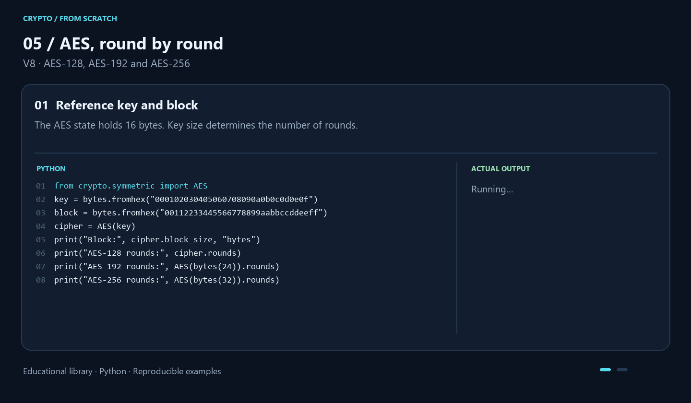

[Still image](docs/assets/aes.png) · Run: `python -m examples.tour aes`

**Reference key and block.** The AES state holds 16 bytes. Key size determines the number of rounds.

```python
from crypto.symmetric import AES
key = bytes.fromhex("000102030405060708090a0b0c0d0e0f")
block = bytes.fromhex("00112233445566778899aabbccddeeff")
cipher = AES(key)
print("Block:", cipher.block_size, "bytes")
print("AES-128 rounds:", cipher.rounds)
print("AES-192 rounds:", AES(bytes(24)).rounds)
print("AES-256 rounds:", AES(bytes(32)).rounds)
```

```text
Block: 16 bytes
AES-128 rounds: 10
AES-192 rounds: 12
AES-256 rounds: 14
```

**Known vector and round trip.** SubBytes, ShiftRows, MixColumns and AddRoundKey transform the state.

```python
encrypted = cipher.encrypt_block(block)
assert encrypted.hex() == "69c4e0d86a7b0430d8cdb78070b4c55a"
assert cipher.decrypt_block(encrypted) == block
print("Ciphertext (hex):")
print(encrypted.hex())
print("Decryption: original block recovered")
```

```text
Ciphertext (hex):
69c4e0d86a7b0430d8cdb78070b4c55a
Decryption: original block recovered
```

</details>

<a id="demo-modes"></a>

<details>
<summary>06 / Choose a mode</summary>

V9 · ECB, CBC, CTR and AES-GCM.

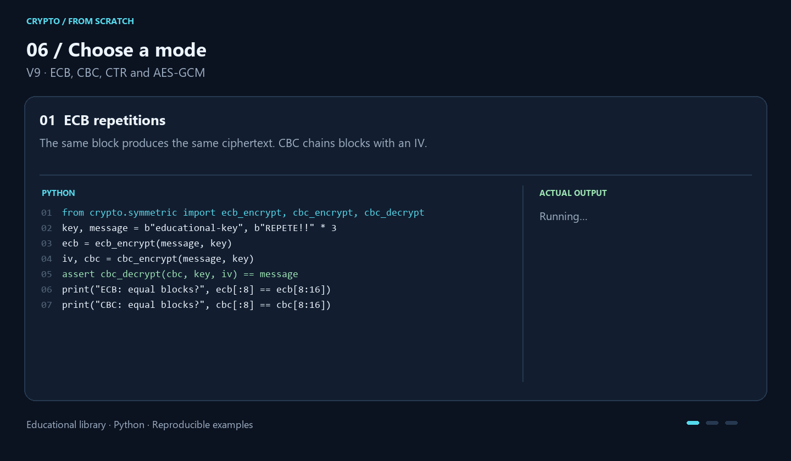

[Still image](docs/assets/modes.png) · Run: `python -m examples.tour modes`

**ECB repetitions.** The same block produces the same ciphertext. CBC chains blocks with an IV.

```python
from crypto.symmetric import ecb_encrypt, cbc_encrypt, cbc_decrypt
key, message = b"educational-key", b"REPETE!!" * 3
ecb = ecb_encrypt(message, key)
iv, cbc = cbc_encrypt(message, key)
assert cbc_decrypt(cbc, key, iv) == message
print("ECB: equal blocks?", ecb[:8] == ecb[8:16])
print("CBC: equal blocks?", cbc[:8] == cbc[8:16])
```

```text
ECB: equal blocks? True
CBC: equal blocks? False
```

**CTR: a reversible stream.** CTR applies XOR with the encrypted stream. Never reuse the nonce.

```python
from crypto.symmetric import ctr_crypt
nonce = b"demo"
ciphertext = ctr_crypt(message, key, nonce)
assert ctr_crypt(ciphertext, key, nonce) == message
print("No padding:", len(ciphertext) == len(message))
print("CTR round trip:", ctr_crypt(ciphertext, key, nonce).decode())
```

```text
No padding: True
CTR round trip: REPETE!!REPETE!!REPETE!!
```

**GCM: encrypt and authenticate.** The tag protects ciphertext and AAD. Verification precedes decryption.

```python
from crypto.symmetric import gcm_encrypt, gcm_decrypt
aes_key = bytes(range(16))
nonce, ciphertext, tag = gcm_encrypt(b"Bonjour", aes_key, aad=b"Alice")
plaintext = gcm_decrypt(ciphertext, aes_key, nonce, tag, aad=b"Alice")
assert plaintext == b"Bonjour"
print("Message:", plaintext.decode())
print("Nonce / tag:", len(nonce), "/", len(tag), "bytes")
```

```text
Message: Bonjour
Nonce / tag: 12 / 16 bytes
```

</details>

<a id="demo-authentication"></a>

<details>
<summary>07 / Prove and verify</summary>

V10–V11 · HMAC and educational RSA signatures.

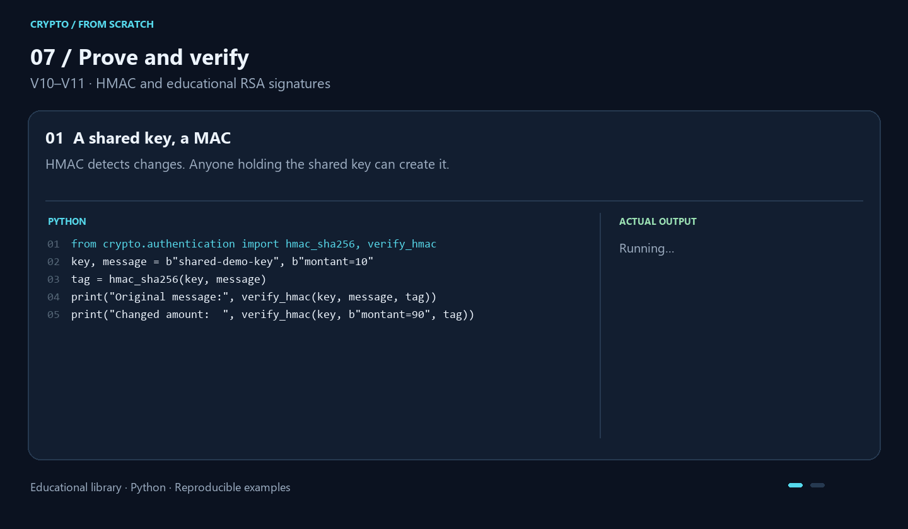

[Still image](docs/assets/authentication.png) · Run: `python -m examples.tour authentication`

**A shared key, a MAC.** HMAC detects changes. Anyone holding the shared key can create it.

```python
from crypto.authentication import hmac_sha256, verify_hmac
key, message = b"shared-demo-key", b"montant=10"
tag = hmac_sha256(key, message)
print("Original message:", verify_hmac(key, message, tag))
print("Changed amount:  ", verify_hmac(key, b"montant=90", tag))
```

```text
Original message: True
Changed amount:   False
```

**A private key, a signature.** The public key verifies. This RSA demonstration does not implement PSS.

```python
from crypto.rsa import generate_keypair
from crypto.signatures import sign, verify
public, private = generate_keypair(512)
signature = sign(message, private)
print("Valid signature:", verify(message, signature, public))
print("Changed message: ", verify(message+b"!", signature, public))
```

```text
Valid signature: True
Changed message:  False
```

</details>

<a id="demo-channel"></a>

<details>
<summary>08 / Alice talks to Bob</summary>

V12 · Authenticate, encrypt and reject replays.

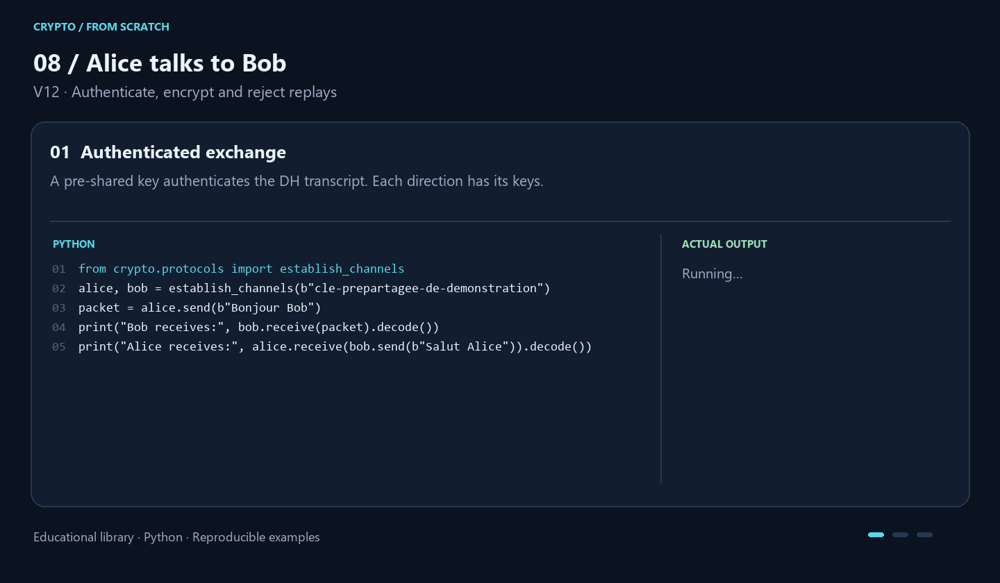

[Still image](docs/assets/channel.png) · Run: `python -m examples.tour channel`

**Authenticated exchange.** A pre-shared key authenticates the DH transcript. Each direction has its keys.

```python
from crypto.protocols import establish_channels
alice, bob = establish_channels(b"cle-prepartagee-de-demonstration")
packet = alice.send(b"Bonjour Bob")
print("Bob receives:", bob.receive(packet).decode())
print("Alice receives:", alice.receive(bob.send(b"Salut Alice")).decode())
```

```text
Bob receives: Bonjour Bob
Alice receives: Salut Alice
```

**Reject replays.** The counter tracks order. A previously accepted packet cannot be read again.

```python
try:
    bob.receive(packet)
except ValueError:
    print("Old packet: REJECTED")
```

```text
Old packet: REJECTED
```

**Detect tampering.** The recipient verifies the HMAC before decrypting the content.

```python
from dataclasses import replace
next_packet = alice.send(b"Message suivant")
try:
    bob.receive(replace(next_packet, tag=bytes(32)))
except ValueError:
    print("Changed tag: REJECTED")
print("Original accepted:", bob.receive(next_packet).decode())
```

```text
Changed tag: REJECTED
Original accepted: Message suivant
```

</details>

<a id="demo-attacks"></a>

<details>
<summary>09 / Break toy parameters</summary>

V13 · Five bounded local experiments.

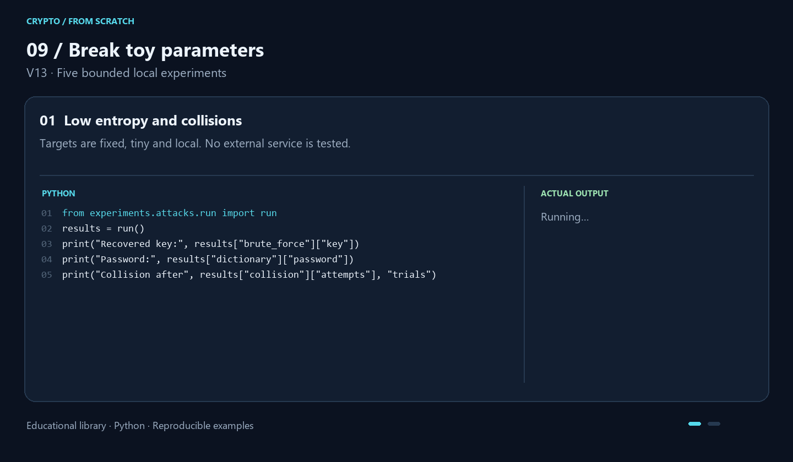

[Still image](docs/assets/attacks.png) · Run: `python -m examples.tour attacks`

**Low entropy and collisions.** Targets are fixed, tiny and local. No external service is tested.

```python
from experiments.attacks.run import run
results = run()
print("Recovered key:", results["brute_force"]["key"])
print("Password:", results["dictionary"]["password"])
print("Collision after", results["collision"]["attempts"], "trials")
```

```text
Recovered key: 173
Password: bonjour123
Collision after 54 trials
```

**MITM and factorization.** Unauthenticated DH allows two secrets; RSA factors recover the private key.

```python
mitm = results["mitm"]
print("Alice / Bob secret:", mitm["alice_secret"], "/", mitm["bob_secret"])
print("Mallory intercepts:", mitm["intercepted"])
rsa = results["factorization"]
print("RSA factors:", rsa["p"], rsa["q"])
print("Recovered message:", rsa["recovered_message"])
```

```text
Alice / Bob secret: 6 / 15
Mallory intercepts: True
RSA factors: 53 61
Recovered message: 42
```

</details>

<a id="demo-benchmarks"></a>

<details>
<summary>10 / Measure before concluding</summary>

V14 · Fixed workloads, time and allocations.

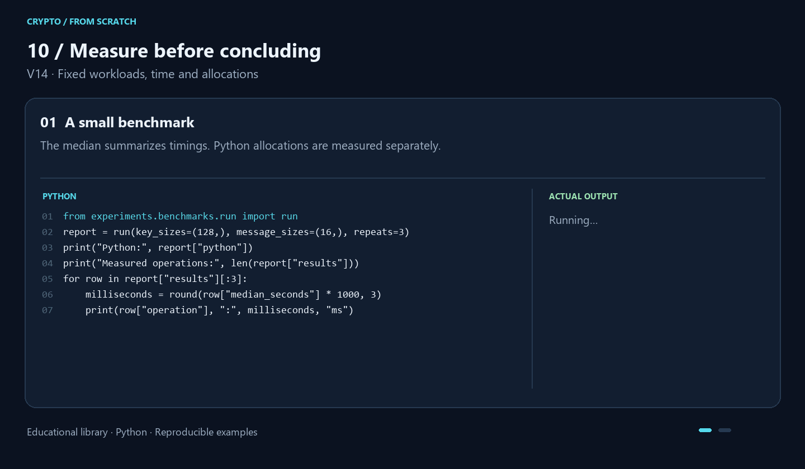

[Still image](docs/assets/benchmarks.png) · Run: `python -m examples.tour benchmarks`

**A small benchmark.** The median summarizes timings. Python allocations are measured separately.

```python
from experiments.benchmarks.run import run
report = run(key_sizes=(128,), message_sizes=(16,), repeats=3)
print("Python:", report["python"])
print("Measured operations:", len(report["results"]))
for row in report["results"][:3]:
    milliseconds = round(row["median_seconds"] * 1000, 3)
    print(row["operation"], ":", milliseconds, "ms")
```

```text
Python: 3.14.2
Measured operations: 6
rsa_keygen : 1.017 ms
rsa_encrypt : 0.014 ms
rsa_decrypt : 0.135 ms
```

**What the numbers mean.** Results depend on the machine. Small keys remain educational.

```python
row = report["results"][0]
print("Repetitions:", row["repeats"])
print("Pic d'allocations Python:", row["peak_python_bytes"], "bytes")
print("This peak is not process RAM.")
print("A benchmark is not proof of security.")
```

```text
Repetitions: 3
Pic d'allocations Python: 936 bytes
This peak is not process RAM.
A benchmark is not proof of security.
```

</details>
## API reference

Messages are `bytes` unless an API explicitly accepts text. Use UTF-8
`.encode()` / `.decode()` for text. Byte-to-integer encoding is big-endian.
Invalid mathematical parameters, malformed envelopes and failed authentication
raise `ValueError`; APIs requiring bytes may raise `TypeError`.

| Module | Main interfaces | Contract |
|---|---|---|
| `crypto.math` | `gcd`, `extended_gcd`, `mod_inverse`, `mod_pow` | Bézout returns `(g, x, y)`; inverse needs coprime inputs; modular powers support negative exponents when an inverse exists |
| `crypto.math` | `is_prime`, `is_probable_prime`, `generate_prime`, `factorize` | Trial division for small numbers; deterministic Miller–Rabin bases below `2**64`, random witnesses above; prime generation uses `secrets` |
| `crypto.rsa` | `generate_keypair`, `PublicKey`, `PrivateKey` | Returns `(public, private)`; JSON serialization is available; private-key JSON is unencrypted |
| `crypto.rsa` | `encrypt_int`, `decrypt_int` | Requires an integer in `[0, n)`; textbook RSA |
| `crypto.rsa` | `encrypt_bytes`, `decrypt_bytes`, `encrypt_text`, `decrypt_text` | Preserves byte length and leading zeroes using `EncryptedMessage(blocks, length)`; no security padding |
| `crypto.diffie_hellman` | `Party(prime, generator, private=None)` | `.public` and `.shared_secret(peer_public)`; no peer authentication |
| `crypto.hashes` | `sha256(data)`, `SHA256(data=b"")`, `educational_hash` | SHA-256 returns 32 bytes; incremental `.update()`, `.digest()`, `.hexdigest()`; weak hash is deliberately unsuitable for security |
| `crypto.symmetric` | `AES(key)` | 16/24/32-byte keys; `.encrypt_block()` and `.decrypt_block()` operate on one 16-byte block |
| `crypto.symmetric` | `FeistelCipher`, `ecb_encrypt/decrypt`, `cbc_encrypt/decrypt`, `ctr_crypt` | Educational 8-byte block cipher; CBC returns `(iv, ciphertext)`; CTR uses a 4-byte nonce |
| `crypto.symmetric` | `gcm_encrypt`, `gcm_decrypt` | AES-GCM, 16-byte tags, AAD support; encryption returns `(nonce, ciphertext, tag)`; verify before decrypting |
| `crypto.authentication` | `hmac_sha256`, `verify_hmac` | 32-byte tags; constant-time tag comparison via `secrets.compare_digest` |
| `crypto.signatures` | `sign(message, private)`, `verify(message, signature, public)` | Educational hash-then-RSA; modulus must accommodate all 256-bit digests; no PSS |
| `crypto.protocols` | `Handshake`, `establish_channels`, `SecureChannel`, `Packet` | PSK-authenticated handshake, one-use completion, directional keys, 64-bit counters; rejects replay, reflection and unordered delivery |

For a fixed composite and independent random Miller–Rabin witnesses, the false
acceptance bound is `4**(-rounds)`. This is not a posterior probability that an
accepted number is composite. Below `2**64`, the implementation uses a fixed
seven-base deterministic test instead.

Further explanations: [mathematics](docs/mathematics/fondations.md),
[RSA and OAEP](docs/cryptography/rsa.md), [Diffie–Hellman](docs/cryptography/diffie_hellman.md),
[SHA-256](docs/cryptography/hash.md), [symmetric modes](docs/cryptography/symmetric.md),
[AES-GCM](docs/cryptography/aes_gcm.md), [authentication](docs/cryptography/authentication.md),
[the channel](docs/cryptography/secure_channel.md). These course notes are in French.

## Experiments and reproducibility

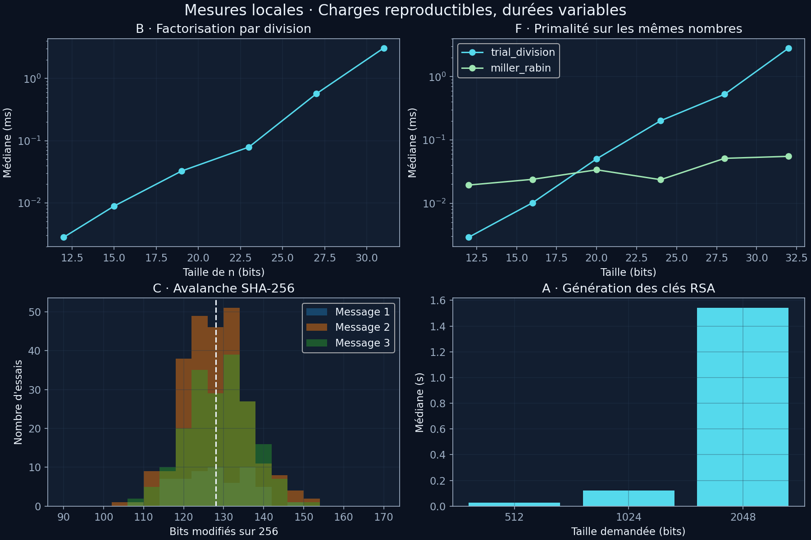

The [A–F report](docs/experiments.md) describes hypotheses, protocols, measured
results and limits. [Recorded science data](docs/results/science.json) includes
inputs, repetitions and platform information. Timings depend on Python, the
machine and random prime generation; they do not establish cryptographic security.

```console
python -m experiments.avalanche.run
python -m experiments.modes.ecb_vs_cbc
python -m experiments.benchmarks.run --key-sizes 256 512 --message-sizes 16 256 --repeats 3
python -m experiments.science.run
```

The last command refreshes the scientific results. Benchmark timing and Python
allocation peaks are measured separately. Allocation peaks are not total process
RAM. The five toy attacks are local brute force, dictionary search, truncated
hash collision, unauthenticated DH interception and tiny RSA factorization.

Regenerate the English walkthrough and figures from the executable examples:

```console
python -m scripts.build_docs
python -m scripts.verify_docs
```

The README is generated from `docs/readme_header.md`, `examples/tour.py` and
`docs/readme_footer.md`; edit those sources so regeneration preserves changes.
The original study report remains in French.

## Validation

```console
python -m pytest
python -m scripts.verify_docs
```

The suite covers independent SHA-256/HMAC references, AES/GCM known-answer
vectors and `cryptography` comparisons, number-theory properties, Unicode and
block boundaries, invalid keys/inputs, authenticated transcripts, tampering,
replay and the workbench's local HTTP boundary. Passing tests are evidence of
specified behavior, not a cryptographic audit.

To check the UI and regenerate actual browser captures:

```console
python -m pip install -e ".[ui-test]"
python -m playwright install chromium
python -m crypto.lab
```

In another terminal:

```console
python -m scripts.check_lab_ui --publish-assets
```

Browser checks exercise all eight workspaces, three experiment modes, JSON
export, GCM rejection, HTML escaping, invalid inputs, keyboard focus, deep links,
offline feedback and layouts at 320, 390, 768 and 1440 CSS pixels. Captures land
in the ignored `output/playwright/` directory; `--publish-assets` refreshes the
README's desktop/mobile images and interface GIF. Browser dependencies are
optional and never used by the crypto library or lab server.

[GitHub Actions](.github/workflows/tests.yml) runs the Python suite on 3.10,
3.12 and 3.14, checks documentation, and runs a Chromium UI check. A local pass
does not imply the hosted workflow has already run.

## Repository map

```text
crypto/          Number theory, ciphers, hashes, authentication and protocols
  lab/           Local HTTP workbench and offline browser assets
examples/        Runnable demonstrations and the animated walkthrough source
experiments/     Avalanche, block modes, attacks, benchmarks and studies A–F
tests/           Algorithm, protocol and workbench tests
scripts/         Documentation generation, verification and browser checks
docs/            Explanations, design references, figures and measured JSON
maharavo.txt     Original project specification
```

## Security scope

- Algorithms are readable educational implementations, without constant-time
  guarantees or third-party audit.
- AES-GCM validates reference vectors, but reference compatibility does not make
  this Python implementation suitable for real secrets.
- Raw RSA, tiny DH parameters, visible demonstration keys and the custom Feistel
  cipher are intentional learning devices.
- The lab listens only on loopback, stores no requests/results, loads no remote
  assets, and limits expensive inputs. It is a single-user local tool.
- Use audited cryptographic libraries and established protocols for real systems.

See the [detailed limitations](docs/security/limitations.md) and
[lab guide](docs/lab.md) for precise boundaries.

## Contributing and license

Follow [CONTRIBUTING.md](CONTRIBUTING.md), run the relevant checks, and keep
algorithm explanations and executable demonstrations consistent. The project
uses the [MIT license](LICENSE). Changes are recorded in [CHANGELOG.md](CHANGELOG.md).
